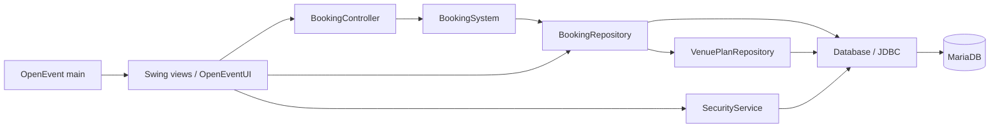

# OpenEvent

A Java Swing desktop application for hosts to manage events and customers to book assigned seats.

  

## Overview

OpenEvent is an OOP coursework project for event hosts and customers. Hosts create and publish concerts, sports matches, and movie screenings; customers discover upcoming events, choose seats, and keep their tickets and receipts.

Accounts, layouts, bookings, and payment records persist in a relational database. Transactions keep seat availability and tickets consistent. Payments and refunds are simulations: the app does not charge a card or transfer money.

## Table of contents

- [Screenshots or demo](#screenshots-or-demo)
- [Features](#features)
- [Tech stack](#tech-stack)
- [Architecture](#architecture)
- [Project structure](#project-structure)
- [Getting started](#getting-started)
- [Configuration](#configuration)
- [Usage](#usage)
- [Testing](#testing)
- [Project status and roadmap](#project-status-and-roadmap)
- [Documentation](#documentation)
- [Contributing](#contributing)
- [Team or authors](#team-or-authors)
- [Credits and acknowledgments](#credits-and-acknowledgments)
- [License](#license)

## Screenshots or demo

TODO: Add screenshots of the running application at these exact paths. These are placeholders; the folder and files do not exist yet.

| View | Screenshot to be added |
| --- | --- |
| Login and registration | [docs/screenshots/login.png](docs/screenshots/login.png) |
| Host venue editor | [docs/screenshots/host-venue-editor.png](docs/screenshots/host-venue-editor.png) |
| Customer seat selection | [docs/screenshots/customer-seat-selection.png](docs/screenshots/customer-seat-selection.png) |

## Features

| Area | Status | Functionality |
| --- | --- | --- |
| Accounts | Available | Host/Customer registration, role-based sign-in, password visibility controls, and salted PBKDF2 password hashes. |
| Customer discovery | Available | Search upcoming published events by title and view details/prices. |
| Customer booking | Available | Navigate section seat maps, buy available assigned seats, and view tickets/text receipts. |
| Host events | Available | Create, edit, save, and publish concerts, sports matches, and movie screenings. |
| Host venues | Available | Start with a stage and no sections; add, move, resize, rename, and color sections; edit rows, seats, and aisles. |
| Ticket offers | Available | Add/rename ticket types, set prices/colors and Early Bird eligibility; share an offer across sections. |
| Payments/refunds | Available | Simulate cash, e-wallet, and card outcomes; cancel eligible unused tickets before the event and record simulated refunds. |
| Host monitoring | Available | Refresh ticket/sales information and check paid tickets in once using their codes. |
| Data safeguards | Available | Transactional purchase/cancellation, duplicate active-seat protection, ownership checks, and booked-layout protection. |
| Export/scanning | Planned | PDF/spreadsheet exports and QR scanning are report proposals, not current features. |

## Tech stack

Versions come from [pom.xml](pom.xml) unless marked otherwise.

| Layer | Technology | Version | Purpose |
| --- | --- | --- | --- |
| Language/runtime | Java | Release target 17; JDK 17+ | Application and OOP models. |
| Desktop UI | Swing/AWT | Included with JDK | Forms, drawing, and event handling. |
| Build | Maven | Not pinned | Compilation and JAR packaging. |
| Compiler plugin | Maven Compiler Plugin | 3.13.0 | Compile with `release=17`. |
| Packaging plugin | Maven JAR Plugin | 3.4.1 | Entry point and driver classpath manifest. |
| Driver | MySQL Connector/J | 8.4.0 | JDBC access. |
| Database | MariaDB | Not pinned | InnoDB storage; supplied SQL uses MariaDB syntax. |
| IDE | Apache NetBeans | Not pinned | Optional Maven and Swing `.java`/`.form` editing. |
| Gradient component | Project-owned `keeptoo.KGradientPanel` | No separate version | Gradient properties used by the forms. |

XAMPP/phpMyAdmin are the documented local setup tools, not Java dependencies. TODO: Record supported MariaDB and Maven version ranges after validation. The JDBC driver name does not establish that the SQL runs unchanged on every MySQL version.

## Architecture

[`OpenEvent`](src/main/java/com/mycompany/openevent/OpenEvent.java) installs the theme and opens `OpenEventUI` on the Swing event-dispatch thread. Screens call services and repositories; models represent accounts, events, layouts, and tickets. `User`, `Event`, and `Payment` hierarchies demonstrate abstraction, inheritance, and polymorphism; model fields and validation encapsulate state.



| Package/module | Responsibility |
| --- | --- |
| [`model`](src/main/java/com/mycompany/openevent/model) | Domain objects, pricing, layout rules, and payment simulation. |
| [`service`](src/main/java/com/mycompany/openevent/service) | Authentication, authorization, booking, transactions, and persistence. |
| [`ui`](src/main/java/com/mycompany/openevent/ui) | Swing forms, venue/seat editors, navigation, and display helpers. |
| [`keeptoo`](src/main/java/keeptoo/KGradientPanel.java) | Source-owned gradient panel; no external Palette installation is needed to run. |

## Project structure

Tracked project content to three directory levels; generated output, dependency binaries, Git metadata, and private configuration are omitted.

```text
OpenEvent/
|-- database/                          # MariaDB schema and additive migrations
|   |-- schema.sql                     # Complete schema for a new database
|   |-- migration-flexible-venue.sql   # Upgrade older venue storage
|   `-- migration-section-color.sql    # Independent section colors
|-- documentation/                     # Report, QA, and editable UML
|   |-- Group6_OpenEvent_Submission.docx
|   |-- FlexibleVenue_Guide.md
|   |-- OpenEvent_Layout_Host_Portability_QA.md
|   |-- OpenEvent_QA_Report.md
|   |-- OpenEvent_UML_Reference_Audit.md
|   |-- UML_Readme.md
|   |-- OpenEvent-Corrected-Classes.drawio
|   |-- OpenEvent-Corrected-Sequences.drawio
|   |-- FlexibleVenue_Class.drawio
|   `-- FlexibleVenue_Sequences.drawio
|-- src/
|   |-- main/
|   |   |-- java/                      # Entry point, models, services, UI, gradient bean
|   |   `-- resources/                 # Bundled assets
|   `-- test/
|       `-- java/                      # Four explicit plain-Java check programs
|-- .gitignore                         # Excludes local config and build output
|-- config.example.properties          # Database settings template
|-- pom.xml                            # Java target, dependencies, and packaging
|-- README.md                          # Project entry guide
`-- TEAM_SETUP.md                      # Member setup guide
```

The build also reads tracked `lib/runtime/mysql-connector-j-8.4.0.jar`. Legacy KGradientPanel binaries remain under `lib/`, but are not POM dependencies.

## Getting started

### Prerequisites

- JDK 17+ and Maven on your command path; no Maven wrapper or Maven version constraint is supplied.
- A running MariaDB server and administrative access for initial database/user setup. XAMPP is the documented Windows option.
- A desktop session for Swing windows; NetBeans is optional.
- Internet access for Maven dependencies/plugins not already cached.

### Installation and setup

1. Open your complete project copy, including `lib/runtime/mysql-connector-j-8.4.0.jar`.

   ```sh
   cd OpenEvent
   java -version
   mvn -version
   ```

2. Start MariaDB. Create a **new empty** database, select it, and import [database/schema.sql](database/schema.sql). The file does not create/select the database. In an administrative MariaDB command-line session, use:

   ```sql
   CREATE DATABASE openevent CHARACTER SET utf8mb4;
   USE openevent;
   SOURCE database/schema.sql;
   ```

   Run the client from the project root for that relative `SOURCE` path. In phpMyAdmin, select the database and use Import instead. Existing installations should apply only needed [flexible venue](database/migration-flexible-venue.sql) and [section color](database/migration-section-color.sql) migrations. The full schema already includes them; do not use it to reset existing data.

3. Create a restricted local application user in the administrative session. Replace the password placeholder before executing:

   ```sql
   CREATE USER 'openevent_app'@'localhost' IDENTIFIED BY 'REPLACE_WITH_LOCAL_PASSWORD';
   GRANT SELECT, INSERT, UPDATE, DELETE ON openevent.* TO 'openevent_app'@'localhost';
   ```

4. Copy the settings template, then edit `db.url`, `db.user`, and `db.password`. Match your server port; the template uses **3307**.

   Windows PowerShell:

   ```powershell
   Copy-Item config.example.properties config.properties
   ```

   macOS/Linux:

   ```sh
   cp config.example.properties config.properties
   ```

5. Build and run from the project root:

   ```sh
   mvn clean package
   java -jar target/OpenEvent-1.0-SNAPSHOT.jar
   ```

   The login window is the application; there is no application web URL. Keep `target/lib/` beside the JAR: its manifest references `lib/mysql-connector-j-8.4.0.jar`. In NetBeans, open the Maven project, build, and run `com.mycompany.openevent.OpenEvent` (F6). Build before opening forms in Design view.

The package build was verified on Windows with JDK 25.0.2 and Maven 3.9.11, compiling for Java 17. Database provisioning, configuration copying, GUI launch, and macOS/Linux commands were checked against the files but not executed during this README update.

## Configuration

[`Database.java`](src/main/java/com/mycompany/openevent/service/Database.java) reads environment overrides, then properties, then source fallbacks whenever it opens a connection.

| Name | Default | Meaning |
| --- | --- | --- |
| `db.url` / `OPENEVENT_DB_URL` | Template: `jdbc:mysql://127.0.0.1:3307/openevent` | Host, port, and schema. Source fallback uses `localhost:3307` with `connectTimeout=4000`, `socketTimeout=10000`, `useSSL=false`, and `allowPublicKeyRetrieval=true`. |
| `db.user` / `OPENEVENT_DB_USER` | Template: `openevent_app`; source fallback: `root` | Use the restricted application account from setup. |
| `db.password` / `OPENEVENT_DB_PASSWORD` | Template: placeholder; source fallback: empty | Set your own local database password. |
| JVM property `openevent.config` | `config.properties` in the working directory | Optional alternate properties file. |

For an alternate file:

```sh
java "-Dopenevent.config=config.test.properties" -jar target/OpenEvent-1.0-SNAPSHOT.jar
```

`config.test.properties` is an example filename, not a supplied file or ignored pattern. Keep alternate files with credentials outside the repo or explicitly untracked. Never commit passwords, private database exports, or personal configuration. `.gitignore` excludes `config.properties`.

## Usage

- **First run:** create Host and Customer accounts using the login controls. Select the matching role when signing in. An empty schema has no accounts/events; the optional [`DemoData`](src/main/java/com/mycompany/openevent/service/DemoData.java) utility is separate from startup.
- **Host:** create an event and enter its details. Click **Add section**, then the canvas; drag objects to move them and use bottom-right corners to resize. Click a section to edit its grid, name, color, shape, and offer. Use **Ticket types** for custom offers, then save and publish.
- **Customer:** open a published upcoming event, choose a section and available seat, and complete a simulated checkout. View saved tickets/receipts in My tickets. Cancel eligible unused tickets before the event starts.
- **Check-in:** the owning Host selects the event and enters the ticket code. Successful entry marks it used; repeated use is rejected.

Saved flexible venues allow 1–12 sections, 1–10 rows and columns per section, up to 1,200 assigned seats, and 1–20 ticket types. Rectangles/trapezoids use a scaled 1000 × 700 logical canvas. Booked geometry is protected. Refresh for other users’ changes; availability is not broadcast live.

## Testing

Four executable check classes are included, with no JUnit dependency or configured harness runner. `mvn test`/`mvn package` compiles them but does **not** execute their `main` methods automatically.

| Harness | Coverage | Database required |
| --- | --- | --- |
| `UsabilityChecks` | Layout, retained edits, navigation, and labels; includes retained legacy designer | No |
| `AcceptanceChecks` | Authentication, access rules, purchase, rollback, duplicate/concurrent booking, refund, check-in | Yes |
| `FlexibleVenueChecks` | Validation, offers, persistence, snapshots, booked-layout protection | Yes |
| `SimpleGridChecks` | Legacy grid behavior, Host registration, saved offers/layouts | Yes |

After building, run the database-free suite on Windows PowerShell:

```powershell
java "-Djava.awt.headless=true" -cp "target/test-classes;target/classes;target/lib/*" com.mycompany.openevent.UsabilityChecks
```

On macOS/Linux:

```sh
java -Djava.awt.headless=true -cp "target/test-classes:target/classes:target/lib/*" com.mycompany.openevent.UsabilityChecks
```

For integration checks, prepare a separate test database with the same schema and point a private test configuration at it. Harnesses write fixtures and attempt cleanup in `finally`; they need read/write access. Run each explicitly:

```powershell
java "-Dopenevent.config=config.test.properties" -cp "target/test-classes;target/classes;target/lib/*" com.mycompany.openevent.AcceptanceChecks
java "-Dopenevent.config=config.test.properties" -cp "target/test-classes;target/classes;target/lib/*" com.mycompany.openevent.FlexibleVenueChecks
java "-Dopenevent.config=config.test.properties" -cp "target/test-classes;target/classes;target/lib/*" com.mycompany.openevent.SimpleGridChecks
```

On macOS/Linux, replace classpath semicolons with colons. This README update verified the build and all **29 UsabilityChecks assertions**; database suites were not rerun. [Historical QA evidence](documentation/OpenEvent_Layout_Host_Portability_QA.md) includes checks outside the four committed harnesses and is not a count produced by `mvn test`.

## Project status and roadmap

Implemented local coursework application. These proposals come from the [project report](documentation/Group6_OpenEvent_Submission.docx), not a dated delivery commitment.

- [x] Available: accounts, publishing, custom offers, and assigned-seat booking.
- [x] Available: simplified venue editing, Host registration, source-owned gradients, simulated payments/refunds, and check-in.
- [ ] Planned: PDF/spreadsheet exports and database backup/restore controls.
- [ ] Planned: better availability refresh, validation, logging, and an easier check runner.
- [ ] Planned: web/mobile access, hosted database deployment, and sales analytics.
- [ ] Planned: QR scanning and real payment integration.

No TODO, FIXME, or “not implemented” markers were found in application source or SQL during review. Current limits include no free rotation, arbitrary venue polygons, 3D layout, or real payments. `VenueDesigner` and template helpers remain for compatibility; they are not the default new-event editor.

## Documentation

| File | Purpose |
| --- | --- |
| [TEAM_SETUP.md](TEAM_SETUP.md) | Installation, private configuration, portable gradient component. |
| [Venue guide](documentation/FlexibleVenue_Guide.md) | Current workflows, limits, and setup. |
| [Project report](documentation/Group6_OpenEvent_Submission.docx) | Manuals, report-specific UML, database relationships, and test cases. |
| [Current QA checkpoint](documentation/OpenEvent_Layout_Host_Portability_QA.md) | Historical build, functionality, portability, and gesture checks. |
| [Earlier QA report](documentation/OpenEvent_QA_Report.md) | Earlier functionality/UI findings. |
| [UML notes](documentation/UML_Readme.md) and [reference audit](documentation/OpenEvent_UML_Reference_Audit.md) | Historical standalone diagram guidance. |
| [Classes](documentation/OpenEvent-Corrected-Classes.drawio) and [sequences](documentation/OpenEvent-Corrected-Sequences.drawio) | Editable standalone diagrams; see version caveat below. |

The current venue guide states that restored/shared standalone diagrams were left unchanged after the editor revision. Older UML notes describe superseded reports/workflows. Use the current report and source to check the latest editor behavior; do not assume every `.drawio` file is synchronized.

## Contributing

No formal branch/commit convention is defined in the tracked project files. **Suggested convention:** `feature/<topic>`, `fix/<topic>`, or `docs/<topic>` branches with short imperative commit messages.

Keep changes focused, build, and run relevant explicit checks. Preserve paired `.java`/`.form` files when editing NetBeans screens. Document behavior/setup changes and keep credentials out of commits.

## Team or authors

TODO: Replace these placeholders with the team’s chosen attribution.

| Name | Role |
| --- | --- |
| TODO: member name | TODO: role or contribution |

## Credits and acknowledgments

- MySQL Connector/J 8.4.0 supplies the JDBC driver declared in the POM and packaged beside the app.
- Java Swing/AWT supplies desktop controls; Apache NetBeans supports form editing.
- MariaDB supplies storage; XAMPP/phpMyAdmin are used by the documented local setup.
- The gradient panel is project-owned source; retained legacy KGradientPanel binaries are not active Maven dependencies.
- Images/icons are bundled in [src/main/resources/assets](src/main/resources/assets); the image loader uses no runtime CDN. TODO: Identify original creators, sources, and applicable licenses before redistribution.

## License

License: to be decided. No project `LICENSE` file is present. Bundled dependencies and assets may have their own terms.
